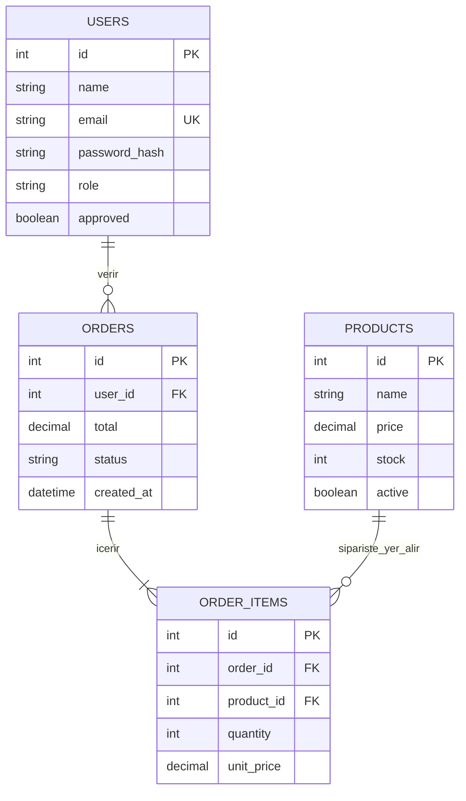
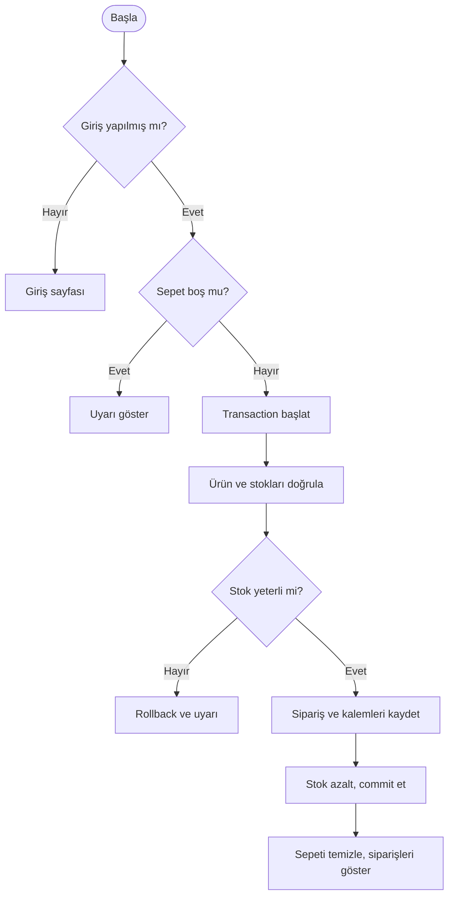

# MAVİ MAĞAZA — İNTERNET ALIŞVERİŞ SİTESİ

## Proje kapağı

| Bilgi | Doldurulacak bilgi |
|---|---|
| Üniversite | **[ÜNİVERSİTE ADI]** |
| Fakülte / Bölüm | **[FAKÜLTE VE BÖLÜM ADI]** |
| Ders kodu ve adı | **[DERS KODU – DERS ADI]** |
| Dersi veren öğretim üyesi | **[AD SOYAD]** |
| Öğrenci 1 | **[AD SOYAD – OKUL NUMARASI]** |
| Öğrenci 2 (varsa) | **[AD SOYAD – OKUL NUMARASI]** |
| Proje adı | Sepetika: İnternet Alışveriş Sitesi |
| Veriliş / teslim tarihi | 26 Ekim 2026 / 23 Kasım 2026 |

Teslimden önce köşeli parantezli alanları doldurun. Proje en fazla iki öğrenciyle hazırlanmalıdır.

## 1. Özet

Bu proje; misafirlerin ürünleri inceleyebildiği, kayıtlı kullanıcıların sepet oluşturup sipariş verebildiği ve yöneticinin ürünlerle kullanıcı onaylarını yönetebildiği bir internet mağazasıdır. Python Flask ve SQLite kullanılmıştır. Uygulama arayüz, sunucu tarafı iş kuralları ve kalıcı veri saklama katmanlarından oluşur. Ödeme gerçek tahsilat yapmaz; sipariş oluşturma ve stok azaltma davranışını eğitim amacıyla örnekler.

**Anahtar kelimeler:** e-ticaret, Flask, SQLite, rol tabanlı erişim, sepet, sipariş.

## 2. Konu, amaç ve yöntem

Amaç, çevrimiçi ürün kataloğu ve sipariş akışını uygulamalı olarak geliştirmek; kullanıcı rollerini ayırmak ve verileri ilişkisel veritabanında saklamaktır. Problem çözme ve gereksinime dayalı yazılım geliştirme yaklaşımı izlenmiştir:

1. İhtiyaç tanımlanır: ürün keşfi, sepet, sipariş ve yönetim.
2. Gereksinimler misafir, üye ve yönetici işlevlerine ayrılır.
3. Veri modeli ve varlık ilişkileri tasarlanır.
4. Flask rotaları, şablonlar ve SQLite ile uygulama geliştirilir.
5. İşlevler demo senaryoları üzerinden kontrol edilir.

Bu çalışma laboratuvar deneyi değildir; gereksinime dayalı tasarım ve senaryo temelli yazılım doğrulamasıdır. Teslim öncesi senaryoları uygulamada deneyip gerçek gözlem/sonuçları ekleyin.

## 3. Tarihçe ve temel bilgiler

Elektronik ticaret internet erişiminin ve güvenli çevrimiçi iletişimin yaygınlaşmasıyla gelişmiştir. Çevrimiçi mağazalar genellikle ürün kataloğu, kimlik doğrulama, sepet, sipariş, stok ve ödeme süreçlerini bütünleştirir. Web uygulaması tarayıcı arayüzü, sunucu uygulaması ve veri katmanından oluşur. HTTP istek/yanıt modeli tarayıcı ile sunucuyu konuşturur; oturum bilgisi kullanıcı durumunu istekler arasında taşır. İlişkisel veritabanı tabloları birincil ve yabancı anahtarlarla bağlanır. CRUD; oluşturma, okuma, güncelleme ve silme işlemleridir. Geçmiş siparişleri korumak için ürün satıştan kaldırılırken kayıt silinmez, `active` alanı değiştirilir.

## 4. Sistem gereksinimleri

**Misafir:** satıştaki ürün ve fiyatları görür. **Üye:** kayıt/giriş yapar, miktar seçer, sepete ekler, sipariş oluşturur ve kendi siparişlerini görür. **Yönetici:** ürün ekler, satış durumunu değiştirir, kullanıcı onayını yönetir ve siparişleri listeler.

İşlevsel gereksinimler: katalog, kayıt ve giriş, stok sınırına uyan sepet, sipariş ve sipariş kalemlerinin kaydı, siparişte stok azaltma, yönetici izinleri ve yetkisiz erişimin engellenmesi. İşlevsel olmayan gereksinimler: Türkçe ve duyarlı arayüz, parola özeti, parametreli SQL ve kalıcı veri.

## 5. Teknolojiler ve mimari

- **Python / Flask:** yönlendirme, oturum, doğrulama ve şablon sunumu.
- **SQLite:** sunucusuz, dosya tabanlı ilişkisel veritabanı.
- **Werkzeug:** parola özeti ve doğrulaması.
- **HTML, Jinja, CSS:** sayfa yapısı ve duyarlı görünüm.

İstek tarayıcıdan Flask rotasına gelir. Rota oturum/rol denetimi yapar, SQLite sorgusunu çalıştırır ve sonucu Jinja şablonuna aktarır. Sepet oturumda, siparişler ve ürünler veritabanında saklanır.

## 6. Veritabanı ve ER diyagramı

`users`: ad, benzersiz e-posta, parola özeti, rol, onay. `products`: ad, açıklama, fiyat, stok ve satış durumu. `orders`: kullanıcı, toplam, durum ve tarih. `order_items`: sipariş, ürün, miktar ve satın alma anındaki birim fiyat. Bir sipariş birden fazla kalem içerir; ürün-sipariş çoktan çoğa ilişkisi ara tabloyla kurulur. Kalemdeki fiyat geçmiş sipariş fiyatını korur.

## 7. Algoritma ve akış şeması

### Sipariş algoritması

1. Oturum açılmamışsa girişe yönlendir.
2. Sepet boşsa uyarı göster.
3. Veritabanı transaction'ı başlat ve her ürünü/stoğu yeniden doğrula.
4. Stok yeterli değilse işlemi geri al ve kullanıcıyı bilgilendir.
5. Toplamı hesapla; siparişi ve kalemlerini kaydet.
6. Stokları azalt, işlemi tamamla ve sepeti temizle.
7. Sipariş geçmişini göster.

### Giriş algoritması

E-posta ile hesabı bul; parola özetini doğrula; hesap onayını kontrol et; başarılıysa oturumu aç. Yönetici rolünü yönetim paneline, üyeyi mağazaya yönlendir. Başarısız durumda açıklayıcı hata göster.

## 8. Arayüz ve kod açıklaması

- Ana sayfa ürün adı, açıklama, fiyat ve stok miktarını gösterir.
- Kayıt/giriş ekranı e-posta ve parola bilgilerini alır.
- Sepet miktar ve toplam tutarı gösterir; sipariş POST isteğiyle oluşturulur.
- Yönetim paneli yeni ürün girişi, satış durumunu değiştirme, kullanıcı onayı ve sipariş listesini sağlar.
- `app.py` veritabanı başlatma, rol denetimleri ve sayfa rotalarını içerir.
- `templates/` sayfaların HTML/Jinja yapısını, `static/style.css` görünümü içerir.
- Sipariş oluşturma transaction kullanır; stok tutarsızlığı halinde kayıt geri alınır.
- Parolalar açık metin tutulmaz, SQL parametreli sorgularla yürütülür.

## 9. Kurulum ve demo

Kurulum komutları `README.md` içindedir. Demo hesabı `admin@magaza.local`, parola `Admin123!` şeklindedir. Uygulamada sırasıyla ürün kataloğunu açın, üye kaydı oluşturun, stok sınırında sepete ürün ekleyin, sipariş verin, sipariş geçmişini ve azalan stoğu gösterin; son olarak yönetici hesabıyla ürünü satıştan kaldırın. Yerel demo parolasını yayına almadan önce değiştirin.

## 10. Sonuç ve geliştirme önerileri

Proje, istenen üç rolü, katalog/sepet/sipariş akışını, veritabanı bağlantısını ve yönetim işlevlerini örnekleyen çalışır bir uygulama sunar. Sonraki sürümlerde mevcut ürün düzenleme formu, kategoriler, arama, adres yönetimi, sipariş durumu, CSRF koruması, test senaryoları ve gerçek ödeme kuruluşu entegrasyonu eklenebilir.

## Kaynakça

1. Python Software Foundation, *Python Documentation*, https://docs.python.org/3/.
2. Pallets Projects, *Flask Documentation*, https://flask.palletsprojects.com/.
3. SQLite Consortium, *SQLite Documentation*, https://www.sqlite.org/docs.html.
4. OWASP Foundation, *Password Storage Cheat Sheet*, https://cheatsheetseries.owasp.org/.

## Ekler

- Ek A: Kaynak kod (`app.py`, `templates/`, `static/`).
- Ek B: ER diyagramı (Bölüm 6).
- Ek C: Akış şeması ve algoritma (Bölüm 7).
- Ek D: Kod açıklamaları (Bölüm 8).
